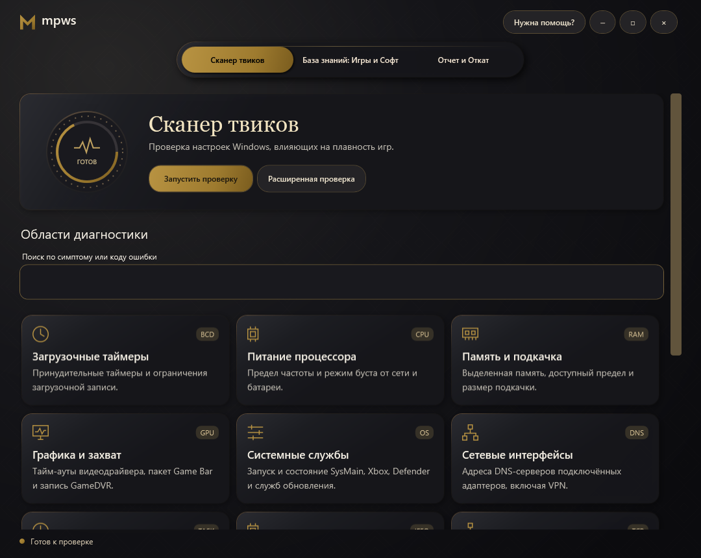
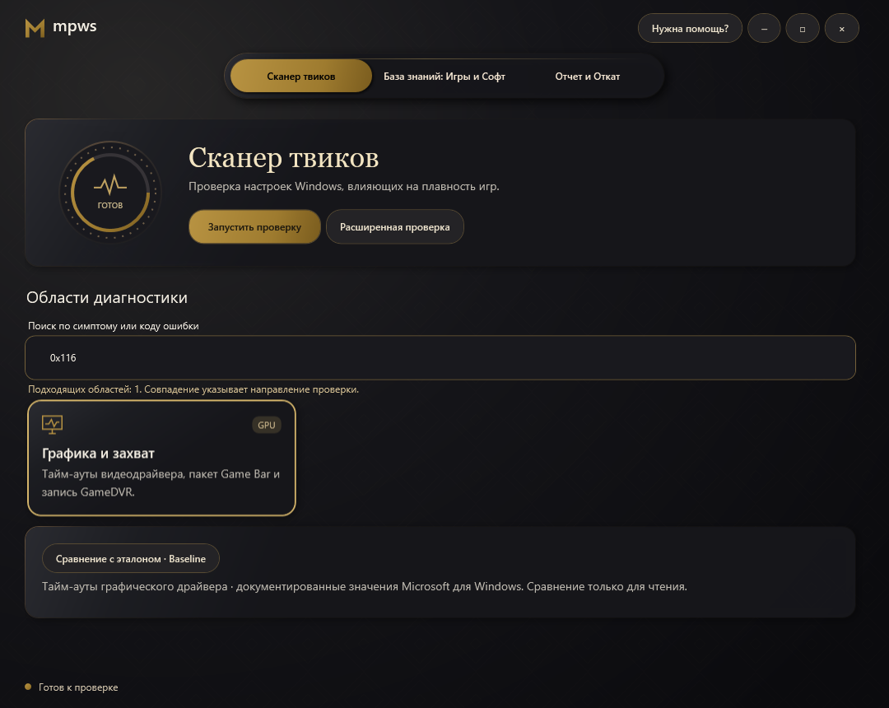

# MPWS

MPWS - Утилита устранения фризов, лагов после оптимизаторов и плохой настройки. Также включает в себя 22 встроенных гайда под конкретные программы и игры. Эксклюзивно для FunPay

**English:** MPWS is a local Windows diagnostics tool for investigating game stutters. The interface, scan results, and guides are in Russian. Scanning is read-only. Changes require a separate recovery action and confirmation.

## Запуск

Откройте `mpws.exe` и нажмите **«Запустить проверку»**. Автономная x64-сборка включает среду .NET. Раздел «Отчет и Откат» позволяет сохранить результат в текстовый файл. Отчёт может содержать имя компьютера и сведения о сетевых интерфейсах — учитывайте это при публикации.

## Что проверяет сканер

- Параметры загрузки Windows и таймеров, ограничения процессора и настройки активной схемы питания.
- Выделенную память, предел её выделения и файл подкачки.
- Параметры восстановления видеодрайвера, службы SysMain, Xbox, Windows Update и Defender.
- Game Bar, GameDVR, системные DNS и приоритет запущенных игровых процессов.

Обычная и расширенная проверки только читают настройки. Расширенная проверка запрашивает права администратора для чтения конфигурации загрузки Windows. Если проверка недоступна, это видно в отчёте. Настройку Fast Boot в UEFI пользователь проверяет вручную.

## Восстановление и откат

Для поддерживаемых таймеров и параметров видеодрайвера кнопка **«Восстановить по умолчанию»** предлагает удалить явное переопределение. После подтверждения MPWS сохраняет исходное значение в системном журнале приложения в реестре и применяет изменение. Снимок доступен во вкладке **«Отчет и Откат»**. Для остальных находок программа показывает инструкцию. Изменения загрузочной конфигурации вступают в силу после перезагрузки.

[Код диагностики](Services/DiagnosticsService.cs) · [Механизм восстановления](Services/Recovery.cs) · [База знаний](Services/KnowledgeBaseService.cs)

## Сборка из исходников

В Windows с установленным .NET 10 SDK выполните из корня проекта:

```powershell
dotnet publish MPWS.csproj -c Release -r win-x64 --self-contained true -p:PublishSingleFile=true -p:IncludeNativeLibrariesForSelfExtract=true -p:DebugType=None -o release
```

Результат сборки — `release/mpws.exe`. Для проверки скачанного файла сравните результат следующей команды с контрольной суммой соответствующего релиза:

```powershell
Get-FileHash .\mpws.exe -Algorithm SHA256
```

## Лицензия

[MIT](LICENSE)


## Версия 1.1.3

Сканер показывает фоновые задания, правила приоритета IFEO, профиль TCP Internet и питание USB. Поиск понимает симптомы и коды ошибок, например «щёлкает звук» или «0x116». В блоке Baseline текущие параметры восстановления GPU сопоставлены с [документированными значениями Microsoft](https://learn.microsoft.com/en-us/windows-hardware/drivers/display/tdr-registry-keys).




